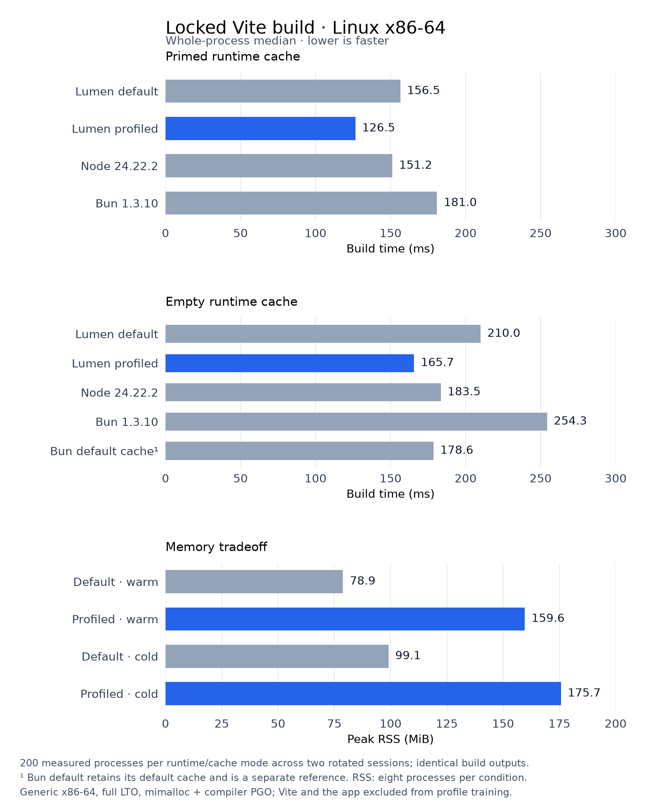

# Vite build comparison — 20 November 2026

The profiled Linux x86-64 CLI completed this locked Vite build faster than Node
and Bun in both measured sessions, with identical output files. This is a result
for one application on one host, not a general JavaScript engine ranking.



| Runtime | Primed runtime cache | Empty runtime cache |
| --- | ---: | ---: |
| Lumen, default build of the same source | 156.5 ms | 210.0 ms |
| **Lumen, mimalloc + compiler PGO** | **126.5 ms** | **165.7 ms** |
| Node 24.22.2 | 151.2 ms | 183.5 ms |
| Bun 1.3.10, explicit cache | 181.0 ms | 254.3 ms |

Bun with its **default cache behavior** was also measured alongside the
empty-cache runs: **178.6 ms**. That is a separate reference, not an empty-cache
result. Relative to the pooled medians, Lumen took 16.3% less time than Node
warm, 9.7% less cold, and 7.3% less than the Bun default-cache reference cold.
The default Lumen column already contains this PR's engine changes; it does not
measure the previous main-branch release.

## What changed

Parsing and module startup perform substantial allocation and AST work before
the app runs. This change reduces that work with compact identifiers, pooled AST
nodes, shared function source, and validated lazy decoding of cached function
bodies. It also expands bytecode coverage, improves x86-64 JIT calls/property
lookup, reduces iterator allocation, and moves POSIX path operations into native
helpers. Regression fixtures cover the affected JavaScript semantics, ownership,
coroutine handoffs, and shutdown.

The final build combines these changes with an optional CLI-only mimalloc
allocator and compiler profile-guided optimization (PGO). PGO trains on generated
parsing/module programs, existing engine benchmarks, and filesystem/hash work.
**Vite, Rollup, esbuild, and this application are excluded from training.**
The compiler targets generic x86-64; no host-specific CPU flag, BOLT rewriting,
preloaded allocator, or special allocator setting was used.

The profiled Linux CLI is built with the reproducible command below. Default
Cargo builds retain ClassAlloc and no third-party native CLI dependencies.
Published artifacts retain their existing build recipes: workflow changes could
not be pushed with the available repository credentials. The measured executable
was built by the same checked-in script and source in this PR.

## Memory and limits

The speed improvement costs memory. Median peak RSS, measured separately with
GNU time across eight fresh processes per condition, increased from **78.9 to
159.6 MiB warm**, and **99.1 to 175.7 MiB cold**. These are Lumen comparisons;
Node and Bun memory were not measured in this final series.

Linux transparent huge-page availability affects this allocator's memory and
speed. Separate diagnostic runs found that disabling those pages reduced RSS
but lost much of the warm speed improvement. No system-wide memory settings
were changed. Use the default Cargo build when its memory tradeoff is preferable.

The host was shared, and filesystem caches remained warm throughout. Absolute
cold times moved between sessions: Lumen 159.4/169.9 ms, Node 171.3/191.2 ms,
and default-cache Bun 161.7/186.5 ms. Both sessions favored Lumen. All measured
samples are retained, including slow samples.

## Method and evidence

- AMD Ryzen 7 PRO 8845HS, Linux x86-64; Rust 1.99.1 / LLVM 23.1.3;
  Node 24.22.2 (V8 13.6.233.17-node.63); Bun 1.3.10; Vite 6.4.6.
- Same `examples/vite-app/package-lock.json` and installed dependencies for all
  engines. Delete `dist` before each run. Time the entire fresh process through
  shutdown, rather than Vite's internal timer.
- Two sessions, each with 100 timed processes per runtime and cache mode,
  rotating runtime order each round: **1,800 timed processes** plus 18 excluded
  warmups. Every process produced identical paths and SHA-256 output hashes.
- Warm: separate explicit runtime caches primed by the excluded warmup.
  Cold: new empty directories for every process. Node/Lumen use
  `NODE_COMPILE_CACHE`; Bun uses `BUN_RUNTIME_TRANSPILER_CACHE_PATH`.
  The additional Bun default reference leaves its cache path unset.
- Within-round paired ratios also favor Lumen in both sessions. The exploratory
  95% bootstrap intervals are wholly below 1 for all Node/Bun comparisons:
  warm/Node 0.825–0.842, warm/Bun 0.698–0.710, cold/Node 0.902–0.912,
  cold/Bun 0.654–0.667, cold/default-cache Bun 0.936–0.954.
  These are stratified by session and follow extensive experimentation; they
  are not preregistered or evidence of performance on other machines/workloads.
- Default and mimalloc CLI integration suites: five tests each. The exact
  measured PGO executable also passed the same five integration tests.
- Fresh full engine run: 848 tests passed. Broader runtime run: 169 passed,
  one ignored, two failed, and one server test was terminated after hanging.
  The failures are the HTTP/2 client and a UDP event-order assertion; both
  reproduced on unchanged `main` (`567395a1`). The HTTP/2 server also timed out
  on unchanged `main`. These remain existing runtime limitations; the full
  runtime suite is **not green**. See [validation.json](validation.json).
- 126 release fixture executions, 36 iterator/oracle configurations, and 49
  byte-identical cache entries between default and profiled Lumen.
- 64 Valgrind Memcheck runs with zero errors on a separate annotated mimalloc
  build using the same PGO profile: 54 fixture/tier runs, eight iterator/GC
  cases, and two Vite builds. Leak checking was disabled; this does not establish
  freedom from leaks. Annotation byte precision was checked separately with a
  deliberate out-of-bounds access.
- An interpreted Fibonacci control improved by a paired median of 13.4%.
  A retained-function workload fell from 1,442.7 to 1,126.7 ms, with peak RSS
  increasing from 97.2 to 105.8 MiB. Neither is a broad workload guarantee.

[measurements.json](measurements.json) includes all timing observations, cache
state, raw memory/control results, paired analysis, compiler versions, training
hashes, and source/binary hashes. The local research commit is recorded for
provenance; the PR is a clean snapshot with the same `crates` Git tree and
recorded source-file hashes, rather than the experiment history.

## Reproduce

Use Linux x86-64, Node and Bun versions above, and a matching Rust/LLVM pair.
The build recipe refuses an existing output directory to avoid reusing profiles.

```sh
npm ci --prefix examples/vite-app --no-audit --no-fund
cargo build --locked --release -p lumen-cli
rustup component add llvm-tools-preview
bash scripts/build-profiled-cli.sh target/profiled-cli
node scripts/check-vite-build.mjs target/profiled-cli/lumen-cli

export LUMEN_TIER=jit LUMEN_TIER_THRESHOLD=8
for session in first repeat; do
  node scripts/bench-vite.mjs --runs 100 --require-parity \
    --lumen target/profiled-cli/lumen-cli --baseline target/release/lumen-cli \
    --bun bun --out "reports/vite-reproduction/warm-$session.json"
  node scripts/bench-vite.mjs --runs 100 --require-parity \
    --lumen target/profiled-cli/lumen-cli --baseline target/release/lumen-cli \
    --bun bun --cold-cache --bun-default-reference \
    --out "reports/vite-reproduction/cold-$session.json"
done
```

Run sessions sequentially on an otherwise quiet host. `--require-parity` checks
the explicit-cache Node/Bun median comparisons; inspect the separately reported
`bunDefaultRatio` as well. Performance is reported, not asserted in shared CI.
Existing engine/script CI applies to this PR. A dedicated profiled CLI job and
release workflow integration remain pending workflow-write permission; the
profiled build and cold/warm output checks were completed locally.

Verify the published observations and source identity, and redraw the figure:

```sh
node docs/benchmarks/vite-profiled-2026-11-20/verify-data.mjs
# Python with matplotlib installed:
python3 docs/benchmarks/vite-profiled-2026-11-20/render-report.py
```
